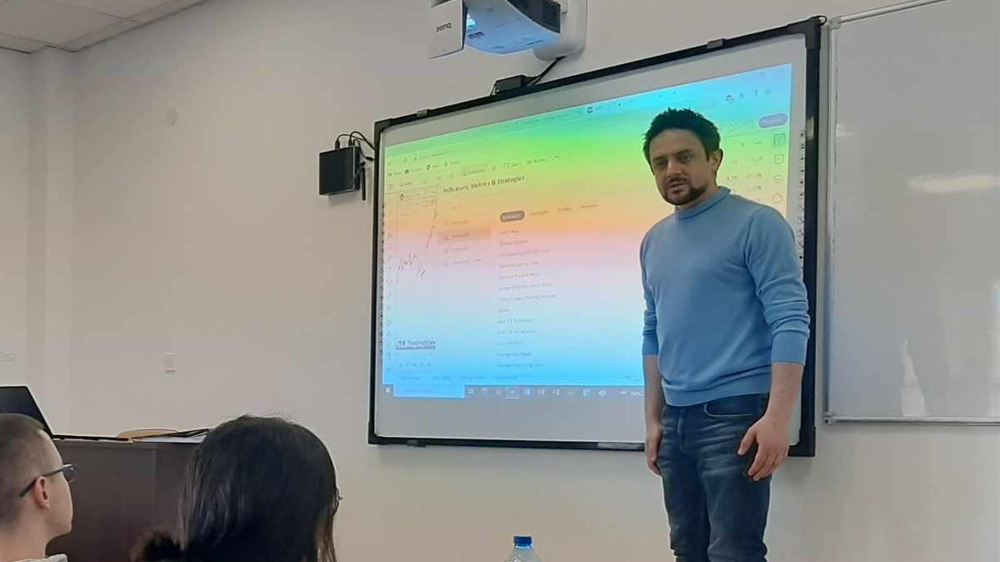
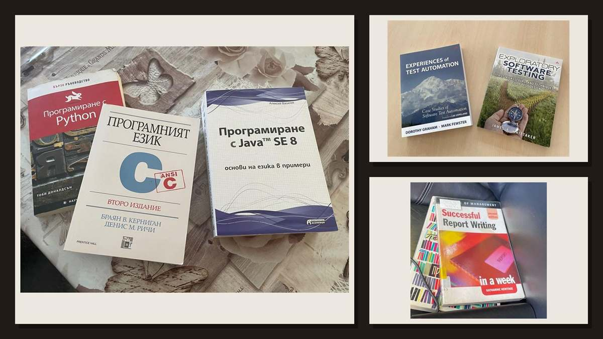
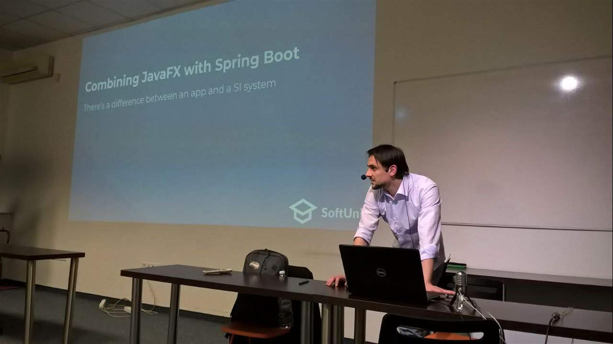

# NIKOLAY (NIK) NENKOV

### Tutor + Developer + Consultant

This is not a CV and it is not a sales page. It is a personal record of my relationship with computers, learning, sharing knowledge and the people I met along the way.

  

## A life around computers

My connection with computers began long before they became my work. As a child I spent time in internet cafes and computer clubs. Later I played and experimented across the local network of a Gabrovo internet provider. In high school I ran a World of Warcraft server and servers for other games, mostly because I wanted to understand how everything connected and worked.

The games I remember are part of the story: Need for Speed II, Prince of Persia, World of Warcraft, Diablo, MU Online, Counter-Strike 1.5, Age of Empires, Age of Mythology, Caesar III, The Sims, Plants vs. Zombies, FarmVille and Heroes of Might and Magic. I also had a Game Boy Color and, around 2003, the smaller PlayStation One.

## Books, code and tutoring

Around 2008–2009 I was deeply involved with C, C++, PHP and SQL. I loved programming for pleasure, following blogs and magazines, going to events, borrowing or receiving books, learning something new and then explaining it to somebody else. I began tutoring around 2010, first through private lessons and coursework problems, and later with interns, university students studying outside regular hours and independent learners.

I earned some of my first money by helping people understand and solve coursework problems and by giving private lessons. I only regret that almost none of my early C++ and PHP history survived.

  

## Real-world developing

I am not only someone who tutors. I also have more than eight years of hands-on experience across large international organisations, cross-border product teams, major enterprise systems and several advanced startups. I intentionally leave employer, client and product names out of this profile.

Most of that work has involved backend and full-stack developing, APIs, integrations, databases and distributed systems. Software testing, data security and the reliability of data moving between systems have always interested me. MQTT is a good example: I used it in three real projects, two of them in substantial client environments.

I do not claim formal academic or pedagogical titles. **Tutor + Developer + Consultant** is the description that feels honest to me.

For the structured professional record, I keep a separate [final CV on Google Docs](https://docs.google.com/document/d/1FBIqVdW6fPONrZhg-0LZJi1PGfEMN7XxVwGB9D4SDZw/edit?usp=sharing). It is intentionally not repeated on this personal page.

  

## What changed

In recent years I have become tired of the work itself. I now write very little code by hand because AI has changed how I approach it. I no longer feel the old desire to spend evenings reading technical material, learning one more framework or playing games. I also question what purpose tutoring should have when AI can explain and generate so much instantly.

What I want most now is simpler: time with friends, walking, and being out in nature. That is also part of my story with technology—not a polished conclusion, just where I am today.

## Tutoring repositories

These repositories are clean, public snapshots of examples I first used to learn and later worked through with other learners. They contain no employer or client identities, production data, credentials, private business logic or proprietary history.

### Java and JVM

- [Spring Boot library](https://github.com/bg3dh4jh6m/tutoring-spring-boot-library) — REST, persistence and testing
- [Java REST API](https://github.com/bg3dh4jh6m/tutoring-java-rest-api) — layered API design
- [Java algorithms](https://github.com/bg3dh4jh6m/tutoring-java-algorithms) — expressions, trees and problem solving
- [Java memoization](https://github.com/bg3dh4jh6m/tutoring-java-memoization) — dynamic programming
- [Java console exercises](https://github.com/bg3dh4jh6m/tutoring-java-console) — introductory and intermediate practice
- [JavaFX with Spring](https://github.com/bg3dh4jh6m/tutoring-javafx-spring) — desktop UI and persistence
- [JavaFX starter](https://github.com/bg3dh4jh6m/tutoring-javafx-starter) — desktop application foundations

### Web development

- [React SPA](https://github.com/bg3dh4jh6m/tutoring-react-spa) — component-based frontend development
- [Angular SPA](https://github.com/bg3dh4jh6m/tutoring-angular-spa) — a historical Angular application exercise
- [Angular API usage](https://github.com/bg3dh4jh6m/tutoring-angular-api-usage) — consuming public APIs safely
- [Angular starter](https://github.com/bg3dh4jh6m/tutoring-angular-starter) — modern Angular foundations
- [Vue component demo](https://github.com/bg3dh4jh6m/tutoring-vue-component-demo) — interactive component design
- [Django REST API](https://github.com/bg3dh4jh6m/tutoring-django-rest-api) — Python API fundamentals
- [AJAX fundamentals](https://github.com/bg3dh4jh6m/tutoring-ajax-fundamentals) — asynchronous browser requests
- [Selenium introduction](https://github.com/bg3dh4jh6m/tutoring-selenium-intro) — browser automation and testing

### Systems, infrastructure and foundations

- [Go API starter](https://github.com/bg3dh4jh6m/tutoring-go-api-starter) — Gin, GORM and PostgreSQL
- [C++ fundamentals](https://github.com/bg3dh4jh6m/tutoring-cpp-fundamentals) — language basics and console practice
- [C++ MQTT CLI](https://github.com/bg3dh4jh6m/tutoring-cpp-mqtt-cli) — command-line and messaging foundations
- [Terraform modules](https://github.com/bg3dh4jh6m/tutoring-terraform-modules) — reusable infrastructure concepts
- [Visual Basic fundamentals](https://github.com/bg3dh4jh6m/tutoring-vb-fundamentals) — desktop programming foundations

## Contact

- Email: [nik.nenkov@icloud.com](mailto:nik.nenkov@icloud.com)
- Phone: [+359 89 238 7117](tel:+359892387117)

The repositories are published for study and review. No license is granted for commercial reuse, redistribution or derivative works.
